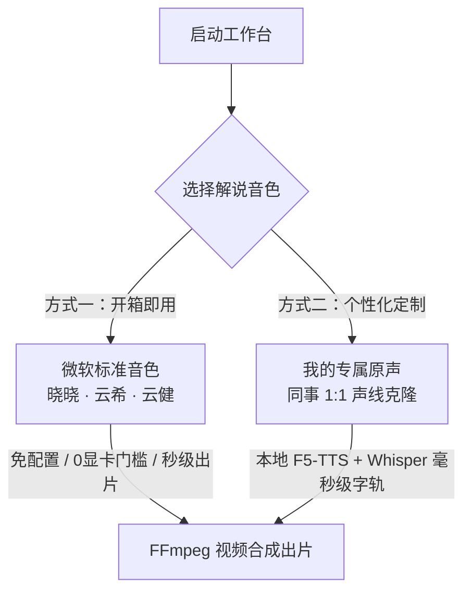

# 🎬 OpenScreen Studio · 软件教程自动化视频工作台

> **“录屏动效自动卡点，AI 大模型严控时长，免 Key 主持人级配音，一键音画字幕秒级出片。”**  
> 专为制作高质量 SaaS 功能演示、后台系统操作教程、产品更新讲解打造的现代化工作台。

---

## 🤖 如果你是让 AI 助手 (Cursor / Claude / Copilot / Antigravity) 帮你安装

**你不需要看任何复杂的代码或配置！** 只需把本仓库链接发给你的 AI 编程助手，直接发送以下两句提示词之一：

### 1. 基础启动（开箱即用 · 微软标准音色）
> *“请帮我安装并启动这个项目，检查系统依赖（Python 和 FFmpeg），启动后告诉我如何打开工作台制作视频。”*

### 2. 进阶定制（我想用我自己的声音配音）
> *“我想用我自己的声音克隆一个专属配音员，请参考仓库中的 `custom_voice/README.md` 和 `AGENTS.md`，一步步指导我录制并帮我配置激活。”*

*(本项目根目录已内置专门针对 AI 助手的执行手册 [AGENTS.md](AGENTS.md)，任何 AI Agent 读完都会全自动为你装配环境并指导操作。)*

---

## 🌟 为什么需要 OpenScreen Studio？

制作高质量软件教程视频通常有三大门槛：
1. **录屏平淡生硬**：普通录屏没有重点，观众看不清鼠标点击在哪里。
2. **解说音画脱节**：录完视频自己配音容易卡顿、语速不一，或者解说还没说完视频就放完了。
3. **后期剪辑费时**：手动对轴、卡点字幕、分段剪辑极其消耗精力。

**OpenScreen Studio + OpenScreen** 组合拳彻底解决这一流程：
- 📸 **录制端（OpenScreen）**：自动捕捉鼠标轨迹，生成专业级平滑镜头缩放、圆角阴影与弹簧光标动效。
- 🧠 **编导端（OpenScreen Studio）**：自动读取录屏工程的**镜头特写与点击交互节拍**，根据视频物理秒数，由大模型（DeepSeek / OpenAI / 智谱等）按分镜**严卡字数预算**，自动撰写音画严密卡点的解说词。
- 🎙️ **合成端（双轨音频架构）**：
  - **开箱即用标准音色**：内置微软 Edge-TTS 广播级自然语音（晓晓、云希、云健等），**完全免费、免 API Key、秒级生成**。
  - **私有专属音色克隆**：支持团队每位同事 **1:1 录入并克隆自己的真实声线**（搭载 F5-TTS 零样本扩散模型 + 广播级母带人声增强链 + Faster-Whisper 毫秒级字轨对齐），一键压制 Apple 风格黑底居中字幕，导出成品 MP4！

---

## 🎙️ 音色选用机制：标准音色 vs 专属音色

为了让大家使用成本最低，工作台设计为**双轨音色架构**：



### 1. 标准音色（初次上手首选，0 配置）
* **包含声音**：晓晓（知性亲和女声）、云希（阳光活力男声）、云健（沉稳影视男声）、晓伊（温柔客服女声）等。
* **特点**：无需下载庞大模型，无需独立显卡，启动后直接可用，生成一段 40 秒配音只需 1 秒钟。

### 2. 专属音色（团队同事 1:1 克隆真实声音）
* **特点**：视频完全由你本人的真实声线朗读，带个人讲师辨识度，且发音极其平稳、不会有真实录音时的卡壳喷麦。
* **详细制作步骤见下文指引**。

---

## 👥 怎样制作并录入我自己的专属音色？（超详细指南）

只需提供一段你本人 **10 ~ 15 秒** 的清晰录音，系统就能提取你的声线指纹！

### 第一步：录制一段 10~15 秒的声音原料
* **录音工具**：手机自带录音机即可（推荐 iPhone 录音机，在手机【设置】->【语音备忘录】->【音频质量】选择**“无损压缩”**，并在控制中心开启**“语音隔离”**）。
* **录音环境**：找一个安静的小房间（关紧门窗，避开空调出风口与空旷回音）。
* **录制技巧**：嘴巴距离麦克风一拳半（15~20cm），保持平时给同事演示系统的自然、自信讲解语速（约 4.0 ~ 4.5 字/秒）。
* **建议朗读文案（直接照着念即可）**：
  > *“大家好，欢迎观看系统功能实操教学。在本期教程中，我将带大家快速了解如何在后台处理新建工单与服务派发流程。”*

### 第二步：将录音文件放入项目
将导出的录音文件（支持 `.wav` / `.m4a` / `.mp3`，推荐保存为 `.wav`）拷贝到本项目的 `custom_voice/` 目录中，例如命名为：
`custom_voice/my_voice.wav`

### 第三步：在 `custom_voice/voices.json` 中登记
打开 `custom_voice/voices.json` 文件（如果没有可以直接创建），追加你的专属配置：

```json
[
  {
    "id": "my_voice",
    "name": "张三 (专属原声)",
    "role": "产品专家 · 1:1复刻",
    "tag": "F5-TTS · 专属音色模型",
    "ref_audio": "my_voice.wav",
    "ref_text": "大家好，欢迎观看系统功能实操教学。在本期教程中，我将带大家快速了解如何在后台处理新建工单与服务派发流程。"
  }
]
```

### 第四步：安装声音克隆扩展依赖
专属音色克隆基于前沿的 F5-TTS 与 Faster-Whisper 模型。只需在终端运行一次安装：
```bash
# 激活虚拟环境后安装声音克隆依赖
pip install f5-tts faster-whisper
```
*(如果通过 AI 助手安装，直接告诉 AI：“帮我安装专属声音克隆扩展”，AI 会自动为你装配完成)*

### 第五步：刷新页面直接使用！
重启或刷新工作台网页：
1. 在 **STAGE 2 · 解说音色与语速校准** 中，你会立刻看到写着你名字的专属音色卡片；
2. 点击卡片右侧的 **▶ 试听按钮**，即可先听为快；
3. 点击 **【🎬 导出成片】**，视频就会完全由你自己的声音进行讲解出片！

---

## 🚀 3 步极速上手（通用安装指引）

### 第一步：安装录屏工具 OpenScreen
OpenScreen 是一款优秀的开源录屏工具（开源版 Screen Studio）。请根据您的操作系统下载安装：

| 平台 | 官方直接下载链接 |
| :--- | :--- |
| **macOS (Apple Silicon M1/M2/M3/M4)** | [Openscreen-macOS-Apple-Silicon-2.1.2.dmg](https://github.com/getopenscreen/openscreen/releases/download/v2.1.2/Openscreen-macOS-Apple-Silicon-2.1.2.dmg) |
| **macOS (Intel 芯片)** | [Openscreen-macOS-Intel-2.1.2.dmg](https://github.com/getopenscreen/openscreen/releases/download/v2.1.2/Openscreen-macOS-Intel-2.1.2.dmg) |
| **Windows (x64)** | [Openscreen.Setup.2.1.2-x64.exe](https://github.com/getopenscreen/openscreen/releases/download/v2.1.2/Openscreen.Setup.2.1.2-x64.exe) |
| **Linux (AppImage)** | [Openscreen-Linux-2.1.2.AppImage](https://github.com/getopenscreen/openscreen/releases/download/v2.1.2/Openscreen-Linux-2.1.2.AppImage) |

*(也可访问 [OpenScreen 官方 Releases 仓库](https://github.com/getopenscreen/openscreen/releases) 获取最新版)*

---

### 第二步：克隆并启动工作台
确保电脑已安装 `python3` (3.9+) 与 `ffmpeg`。

```bash
# 1. 克隆代码并进入目录
git clone https://github.com/a916791360/openscreen-studio.git
cd openscreen-studio

# 2. 一键运行（自动创建独立虚拟环境并打开浏览器）
# macOS / Linux 用户终端运行：
./start.sh

# Windows 用户直接双击运行：
start.bat
```

> **系统依赖提示**：
> - **macOS**：如未安装 FFmpeg，终端执行 `brew install ffmpeg` 即可。
> - **Windows**：终端执行 `winget install Gyan.FFmpeg`。

服务启动后，浏览器将自动打开工作台：**`http://localhost:8765`**。

---

### 第三步：配置大模型 (LLM) 编导引擎

首次使用，点击工作台右上角的 **「模型与提示词设置」**：
1. **选择服务商预设**：支持 **DeepSeek**（高性价比推荐）、**OpenAI**、**智谱 GLM**、**硅基流动** 或 **本地 Ollama**。
2. **填入 API Key**：输入您的 API 密钥，点击 **「测试连通性」** 验证是否握手成功。
3. **点击保存**：配置仅加密保存在本地的 `llm_config.json` 中，受 `.gitignore` 保护，**绝对不会上传或泄露**。

---

## 🎬 极速出片工作流

1. **录制**：打开 OpenScreen 录制一段功能操作（无须出声说话），点击导出为 MP4（如保存到“下载”目录）。
2. **选择**：刷新工作台左下角「录屏媒体库」，系统会自动**秒级匹配**到对应的 OpenScreen 运镜底稿与遥测节拍。
3. **输入要点**：在右侧大文本框输入粗略的操作要点（如：`进入工单管理，新建工单，输入故障现象，指定给张工并提交`）。
4. **智能拟合**：点击上方 **「智能拟合分镜文案」**。AI 会根据特写聚焦、主操作区等时间节拍，严格将字数限制在对应秒数内，生成卡点分镜解说。
5. **试听与调整**：在左下角选择心仪的配音员（标准音色或你的专属原声），点击微标试听；微调语速基准。
6. **一键出片**：点击底部 **「导出成片 (渲染视频 + AI配音 + 同步字幕)」**，系统自动进行音视频合成与字幕压制，提供一键下载与即时播放！

---

## 📂 项目结构说明

```text
openscreen-studio/
├── studio.py                   # 工作台核心多线程服务与 Range-streaming 播放器
├── ai_script_generator.py      # OpenScreen 遥测节拍解析器与大模型时长约束编导引擎
├── custom_voice_tts.py         # 专属音色克隆引擎 (F5-TTS + Faster-Whisper + 广播母带链)
├── generate_tutorial_audio.py  # 独立命令行音频/字幕生成器 (基于 Edge-TTS)
├── custom_voice/               # 👥 团队专属音色库目录
│   ├── README.md               # 专属音色录入详细指南
│   ├── voices.json             # 音色注册表 (动态加载，支持多人多音色)
│   └── ref_clip_engineer.wav   # 预置参考音色范例
├── tokens.css                  # Linear / Raycast 级工业质感设计系统变量
├── sample_tutorial.txt         # 示范台词样本
├── requirements.txt            # Python 基础核心依赖
├── start.sh                    # macOS / Linux 一键极速启动脚本
├── start.bat                   # Windows 一键极速启动脚本
├── AGENTS.md                   # 针对 AI 助手 (Cursor/Claude/Antigravity) 的自动部署指引
└── llm_config.example.json     # 大模型配置模板 (用户填写的真实 Key 本地保留，不上传)
```

---

## 💡 常见问题 Q&A

### Q1：安装后我默认可以使用哪些音色？
**答**：安装启动后，默认自带微软多角色标准音色（晓晓、云希、云健等），直接可用且完全免费免 Key。专属音色（用自己的声音）是按需扩展功能，随时可以录入。

### Q2：如果视频时长较短，AI 润色的台词来不及念完怎么办？
**答：双重硬保障！**
1. **前端与大模型严卡字数**：大模型会按 $4.3 \text{ 字/秒}$ 物理速率严格受限，分镜卡片会实时以绿色标明「字数卡准」。
2. **画面末尾定格保底 (Hold Last Frame)**：即便语速出现微小偏差，系统默认开启保底机制——视频最后一帧自动静止延长，直到配音完整念完，绝不生硬截断语音！

### Q3：如果是同事让 AI 助手帮他安装配置，能直接用吗？
**答：完全可以！** 项目根目录附带了专门为 AI 助手设计的 `AGENTS.md`。同事把代码下载后，直接把仓库交给 Cursor、Claude 或 Antigravity，输入 *“请帮我安装并运行这个项目”*，AI 助手就会自动完成所有环境装配并指导后续操作。

---

## 📄 开源与隐私协议
- 本项目严格保证用户隐私：所有视频与声音处理均在本地离线执行；大模型调用仅请求用户配置的官方 API 地址；绝不包含任何硬编码凭据。
