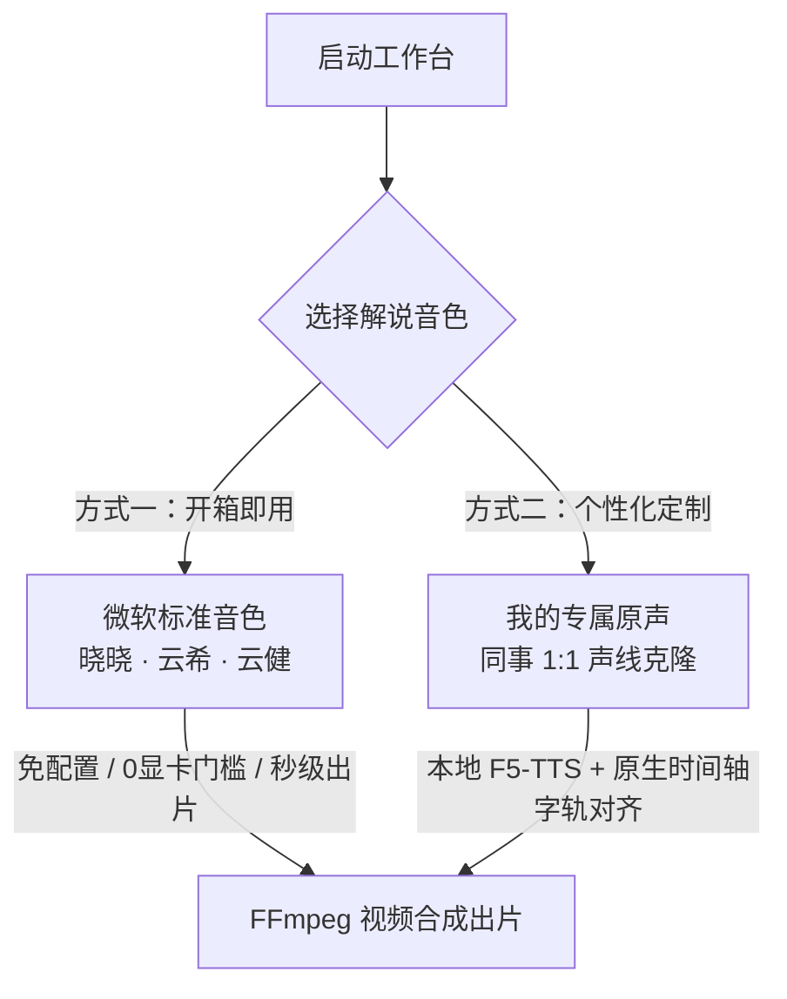

# 🎬 OpenScreen Studio V3.2 · 软件教程自动化视频工作台

[]()
[](LICENSE)
[](https://github.com/a916791360)
[](https://www.python.org/)
[]()

> **“录屏动效自动卡点，AI 大模型严控时长，免 Key 主持人级配音，一键双语字幕秒级出片。”**  
> 专为制作高质量 SaaS 功能演示、出海多语言操作教程、产品更新讲解打造的现代化工作台。

---

## 🤖 如果你是让 AI 助手 (Cursor / Claude / Copilot / Antigravity) 帮你安装

**你不需要看任何复杂的代码或配置！** 只需把本仓库链接发给你的 AI 编程助手，直接发送以下两句提示词之一：

### 1. 基础启动（开箱即用 · 微软标准音色）
> *“请帮我安装并启动这个项目，检查系统依赖（Python 和 FFmpeg），启动后告诉我如何打开工作台制作视频。”*

### 2. 进阶定制（我想用我自己的声音配音）
> *“我想用我自己的声音克隆一个专属配音员，请参考仓库中的 `custom_voice/README.md` 和 `AGENTS.md`，一步步指导我录制并帮我配置激活。”*

*(本项目根目录已内置专门针对 AI 助手的执行手册 [AGENTS.md](AGENTS.md)，任何 AI Agent 读完都会全自动为你装配环境并指导操作。)*

---

## 🌟 为什么需要 OpenScreen Studio？

制作高质量软件教程视频通常有三大门槛：
1. **录屏平淡生硬**：普通录屏没有重点，观众看不清鼠标点击在哪里。
2. **解说音画脱节**：录完视频自己配音容易卡顿、语速不一，或者解说还没说完视频就放完了。
3. **后期剪辑费时**：手动对轴、卡点字幕、分段剪辑极其消耗精力。

**OpenScreen Studio + OpenScreen** 组合拳彻底解决这一流程：
- 📸 **录制端（OpenScreen）**：自动捕捉鼠标轨迹，生成专业级平滑镜头缩放、圆角阴影与弹簧光标动效（支持剪辑裁剪 `trimRegions` 时间轴自动校准）。
- 🧠 **编导端（OpenScreen Studio）**：自动读取录屏工程的**镜头特写与点击交互节拍**（自动将超过 12 秒的连续特写拆细为独立子分镜），并融合 **V3.2 视觉场景切换自动补锚点引擎（FFmpeg Scene Change Detection）**——即使页面路由跳转或全屏弹窗打开时未打 Zoom 特写，也会自动插入独立分镜节点，彻底杜绝跨页串词。
- ⏱️ **分镜级闭环时间轴硬锚定引擎（V3.0+ 核心能力）**：彻底告别传统“靠字数盲猜语速”导致长视频滚雪球抢跑或滞后的痛点——将每段配音严格锁定在对应分镜的物理时间窗 `[p.start, p.end]`（**早念完自动静音等待画面、略超长自动 `1.02x~1.26x` 保调微加速塞入窗口、支持点击分镜卡片 `P_i · Xs ✎` 直接微调开口秒数**）。
- 🛡️ **区间隐私高斯模糊 + 历史项目回载 + 导出卡点九宫格自检（V3.2 新增）**：
  - **区间隐私打码**：支持直接在播放器画面上鼠标框选人脸/邮箱/手机号区域并设定起止秒数，单次导出同步完成高斯模糊脱敏与字幕压制，无需二次压制损画质；
  - **历史项目一键回载**：每次出片自动保存工程快照（视频路径、文案、分镜秒数、打码区间、音色），工作台左上角一键恢复现场继续微调；
  - **导出音画卡点自检报告 & 九宫格**：出片后自动标出偏长加速分镜（`> 1.15x` 预警）并抽取每个分镜起点的带字幕帧拼成高清九宫格，5 秒扫一眼即可验收！
- 🌐 **双语字幕引擎（V2.0+）**：直接复用已绑定的 AI 大模型，基于硬锚定后的精确发声时间轴做小批次上下文翻译与自动拆细补翻（支持英语 / 日语 / 韩语 / 繁中 / 西 / 法 / 德及任意自定义语种），自动以 **ASS 统一整块透明暗底、主大副小无描边美学排版** 烧录画面，同时支持下载标准双语 `.srt`。
- 🎙️ **合成端（双轨音频架构）**：
  - **开箱即用标准音色**：内置微软 Edge-TTS 广播级自然语音（晓晓、云希、云健等），**完全免费、免 API Key、秒级生成**。
  - **私有专属音色克隆**：支持团队每位同事 **1:1 录入并克隆自己的真实声线**（搭载 F5-TTS 零样本扩散模型 + 广播级母带人声增强链 + 原生时间轴对齐技术，杜绝传统语音识别同音错字，字幕与文案 100% 吻合），一键导出成品 MP4！

---

## 🎙️ 音色选用机制：标准音色 vs 专属音色

为了让大家使用成本最低，工作台设计为**双轨音色架构**：



### 1. 标准音色（初次上手首选，0 配置）
* **包含声音**：晓晓（知性亲和女声）、云希（阳光活力男声）、云健（沉稳影视男声）、晓伊（温柔客服女声）等。
* **特点**：无需下载庞大模型，无需独立显卡，启动后直接可用，生成一段 40 秒配音只需 1 秒钟。

### 2. 专属音色（团队同事 1:1 克隆真实声音）
* **特点**：视频完全由你本人的真实声线朗读，带个人讲师辨识度，且发音极其平稳、不会有真实录音时的卡壳喷麦。
* **详细制作步骤见下文指引**。

---

## 👥 怎样制作并录入我自己的专属音色？（超详细指南）

只需提供一段你本人 **10 ~ 15 秒** 的清晰录音，系统就能提取你的声线指纹！

### 第一步：录制一段 10~15 秒的声音原料
* **录音工具**：手机自带录音机即可（推荐 iPhone 录音机，在手机【设置】->【语音备忘录】->【音频质量】选择**“无损压缩”**，并在控制中心开启**“语音隔离”**）。
* **录音环境**：找一个安静的小房间（关紧门窗，避开空调出风口与空旷回音）。
* **录制技巧**：嘴巴距离麦克风一拳半（15~20cm），保持平时给同事演示系统的自然、自信讲解语速（约 4.0 ~ 4.5 字/秒）。
* **建议朗读文案（直接照着念即可）**：
  > *“大家好，欢迎观看系统功能实操教学。在本期教程中，我将带大家快速了解如何在后台处理新建工单与服务派发流程。”*

### 第二步：将录音文件放入项目
将导出的录音文件（支持 `.wav` / `.m4a` / `.mp3`，推荐保存为 `.wav`）拷贝到本项目的 `custom_voice/` 目录中，例如命名为：
`custom_voice/my_voice.wav`

### 第三步：在 `custom_voice/voices.json` 中登记
打开 `custom_voice/voices.json` 文件（如果没有可以直接创建），追加你的专属配置：

```json
[
  {
    "id": "my_voice",
    "name": "张三 (专属原声)",
    "role": "产品专家 · 1:1复刻",
    "tag": "F5-TTS · 专属音色模型",
    "ref_audio": "my_voice.wav",
    "ref_text": "大家好，欢迎观看系统功能实操教学。在本期教程中，我将带大家快速了解如何在后台处理新建工单与服务派发流程。"
  }
]
```

### 第四步：安装声音克隆扩展依赖
专属音色克隆搭载 F5-TTS 零样本扩散模型与独创的**【原文原生时间轴对齐 (Verbatim Native Alignment)】**引擎（100% 还原输入文案，0 错别字、毫秒级音画同步与广播级母带人声增强链）。只需在终端运行一次安装：
```bash
# 激活虚拟环境后安装专属声音克隆扩展
pip install -r requirements-voice.txt
```
*(如果通过 AI 助手安装，直接告诉 AI：“帮我安装专属声音克隆扩展”，AI 会自动为你装配完成)*

### 第五步：刷新页面直接使用！
重启或刷新工作台网页：
1. 在 **STAGE 2 · 解说音色与语速校准** 中，你会立刻看到写着你名字的专属音色卡片；
2. 点击卡片右侧的 **▶ 试听按钮**，即可先听为快；
3. 点击 **【🎬 导出成片】**，视频就会完全由你自己的声音进行讲解出片！

---

## 🚀 3 步极速上手（通用安装指引）

### 第一步：安装录屏工具 OpenScreen
OpenScreen 是一款优秀的开源录屏工具（开源版 Screen Studio）。请根据您的操作系统下载安装：

| 平台 | 官方直接下载链接 |
| :--- | :--- |
| **macOS (Apple Silicon M1/M2/M3/M4)** | [Openscreen-macOS-Apple-Silicon-2.1.2.dmg](https://github.com/getopenscreen/openscreen/releases/download/v2.1.2/Openscreen-macOS-Apple-Silicon-2.1.2.dmg) |
| **macOS (Intel 芯片)** | [Openscreen-macOS-Intel-2.1.2.dmg](https://github.com/getopenscreen/openscreen/releases/download/v2.1.2/Openscreen-macOS-Intel-2.1.2.dmg) |
| **Windows (x64)** | [Openscreen.Setup.2.1.2-x64.exe](https://github.com/getopenscreen/openscreen/releases/download/v2.1.2/Openscreen.Setup.2.1.2-x64.exe) |
| **Linux (AppImage)** | [Openscreen-Linux-2.1.2.AppImage](https://github.com/getopenscreen/openscreen/releases/download/v2.1.2/Openscreen-Linux-2.1.2.AppImage) |

*(也可访问 [OpenScreen 官方 Releases 仓库](https://github.com/getopenscreen/openscreen/releases) 获取最新版)*

---

### 第二步：克隆并启动工作台
确保电脑已安装 `python3` (3.9+) 与 `ffmpeg`。

```bash
# 1. 克隆代码并进入目录
git clone https://github.com/a916791360/openscreen-studio.git
cd openscreen-studio

# 2. 一键运行（自动创建独立虚拟环境并打开浏览器）
# macOS / Linux 用户终端运行：
./start.sh

# Windows 用户直接双击运行：
start.bat
```

> **系统依赖提示**：
> - **macOS**：如未安装 FFmpeg，终端执行 `brew install ffmpeg` 即可。
> - **Windows**：终端执行 `winget install Gyan.FFmpeg`。

服务启动后，浏览器将自动打开工作台：**`http://localhost:8765`**。

---

### 第三步：配置大模型 (LLM) 编导引擎

首次使用，点击工作台右上角的 **「模型与提示词设置」**：
1. **选择服务商预设**：支持 **DeepSeek**（高性价比推荐）、**OpenAI**、**智谱 GLM**、**硅基流动** 或 **本地 Ollama**。
2. **填入 API Key**：输入您的 API 密钥，点击 **「测试连通性」** 验证是否握手成功。
3. **点击保存**：配置仅加密保存在本地的 `llm_config.json` 中，受 `.gitignore` 保护，**绝对不会上传或泄露**。

---

## 🎬 极速出片工作流与 100% 音画同步教程

### 一、为什么 V3.0 能做到 100% 音画同步（零抢跑 / 零滞后）？

在 1~5 分钟的中长视频教程中，为什么传统配音方式容易出现“前面还能对上，越往后声音比画面快十多秒”的问题？
- **传统连续朗读的痛点**：旧方式把所有段落拼成一整条音频从 `0.0s` 一口气连读到底，段与段之间没有按画面的实际动作秒数停顿对齐。由于不同音色（尤其是个人克隆原声 `F5-TTS` 与标准音色 `Edge-TTS`）以及中英文术语的实际朗读速率存在自然波动，每段哪怕只快 `0.8 秒`，滚雪球累加到第 12 段就会提前 10 秒以上（出现“嘴已经讲完下一步了，画面还没开始点”的错位）。

**OpenScreen Studio V3.0 升级为「分镜容量匹配 + 闭环时间轴硬锚定 (Phase-Locked Audio Alignment)」双层机制：**
1. **文案层（分镜容量一对一匹配）**：每个分镜阶段 `P1 ~ Pn` 根据其物理时间窗 `[p.start, p.end]` 计算推荐字数容量（`char_budget`），确保每一段只讲该时间窗内画面正在发生的动作，不跨段抢戏。
2. **音频层 · 早到自动等画面（Silence Padding）**：合成时每段配音若比该分镜画面先念完，系统自动在段尾插入精确静音（带 `12ms` 渐入渐出零爆音），**死死等到下一段分镜的物理起始秒数 `p.start` 才准时开口**，前一段的语速波动绝不传染给下一段。
3. **音频层 · 偏长自动微加速（Adaptive Atempo）**：若某段台词朗读时长略超该分镜时间窗，系统仅对该段做 `1.02x ~ 1.26x` 保调无损微加速塞回窗口内，绝不推迟后续分镜。
4. **句内逗号与句号智能呼吸**：同一分镜内部包含多句话时，句中逗号保持紧凑（`0.16s`），句末句号自动吸收分镜内富余时间，杜绝句中卡顿与段尾长留白。

---

### 二、保证音画严密卡点的 4 步标准制作流程（推荐教程）

#### 第一步：使用 OpenScreen 录制并保留运镜节拍
- 打开 OpenScreen 录制软件操作过程（无需出声说话），导出为 MP4（如保存到 `Downloads` 下载目录）。
- **卡点技巧**：在关键操作或切换区域时保留/添加 OpenScreen 的 `Zoom` 镜头特写。工作台导入视频后会自动读取 `.openscreen` 工程中的特写与点击遥测，并将连续超过 12 秒的长特写自动拆细为独立的 `P1 ~ Pn` 分镜锚点。

#### 第二步：按 `P1 ~ Pn` 分镜结构准备解说文案（二选一）
- **方式 A（工作台内置 AI 一键拟合）**：
  1. 在工作台右侧文本框输入粗略的操作说明草稿；
  2. 点击上方 **「智能拟合分镜文案」**，系统会按 `P1 ~ Pn` 的时间窗生成对应段数的解说词。
- **方式 B（配合 AI 助手抽帧精写 · 推荐复杂长视频使用，准确率最高）**：
  直接把导出的 MP4 路径与你的操作说明发给 AI 助手（Cursor / Claude / Antigravity），使用以下 V3.0 标准提示词：
  ```text
  帮我为这个 OpenScreen 录屏写一套能直接卡点的配音解说文案：
  1. 先解析视频对应的 OpenScreen 运镜特写、点击节拍以及各分镜阶段（P1~Pn）的时间窗 [start, end] 与推荐字数容量（char_budget），并抽关键帧确认每个时间窗内的真实操作画面；
  2. 结合我的操作说明，严格按每个分镜时间窗内的真实动作一对一编写对应段落台词（每段字数贴合该分镜的推荐字数容量，不跨段提前剧透后续动作）；
  3. 直接输出可粘贴的纯文本：同一分镜阶段内用单换行，不同分镜阶段（P1~Pn）之间严格用空行隔开，方便直接粘贴进工作台由 V3.0 分镜时间轴硬锚定出片；
  4. 文案为自然语言贴合我语气，清晰易懂，保证片头、片中与片尾每个动作都严密卡点。

  视频路径：</path/to/export-xxx.mp4>
  操作说明：<在这里写你的操作步骤说明>
  ```
  > ⚠️ **重要提醒**：将 AI 助手按照 `P1 ~ Pn` 写好的分段纯文本粘贴进工作台后，**此时所有分镜卡片已直接变为绿色对齐状态，请直接进入下一步导出，不要再点击「智能拟合分镜文案」**（避免大模型二次改写破坏已对齐的分段结构）。

#### 第三步：核对分镜卡片 & 按需点击 `P_i · Xs ✎` 微调开口秒数
- **段落对应规则**：文本框中**用空行隔开的每一段**，严格对应上方的一张分镜卡片 `P1, P2, ..., Pn`；**同一分镜内部换行请使用单换行**（不要多敲空行）。
- **手动微调开口时间**：如果画面中有某个动作没有打 Zoom 特写，或者你想让某段台词提前/延后 1~2 秒开口，直接点击该分镜卡片左上角的 **`P_i · Xs ✎`**，输入目标秒数即可。合成时配音会分秒不差地钉在该秒数开口。

#### 第四步：选择音色与双语字幕，一键合成出片
1. 在左侧选择 **标准音色（晓晓/云希等）** 或 **你的专属克隆原声（F5-TTS）**；
2. 按需勾选 **「双语字幕」**，选择目标语种与「上译文·下原文 / 上原文·下译文」版式；
3. 点击底部 **「导出成片 (渲染视频 + AI配音 + 同步字幕)」**：后端将依次执行 **TTS 语音合成 → V3.0 分镜时间轴闭环硬锚定 → 双语小批次防漏翻与 ASS 无描边暗底排版 → FFmpeg 高清压制**，支持在线预览及 MP4 / MP3 / SRT 一键下载！

---

## 📂 项目结构说明

```text
openscreen-studio/
├── studio.py                   # 工作台核心多线程服务与 Range-streaming 播放器
├── ai_script_generator.py      # OpenScreen 遥测节拍解析、大模型编导与双语 ASS/SRT 字幕引擎
├── custom_voice_tts.py         # 专属音色克隆引擎 (F5-TTS 扩散推理 + 原生字轨对齐 + 广播母带链)
├── requirements-voice.txt      # 专属声音克隆扩展依赖清单 (可选)
├── generate_tutorial_audio.py  # 独立命令行音频/字幕生成器 (基于 Edge-TTS)
├── custom_voice/               # 👥 团队专属音色库目录
│   ├── README.md               # 专属音色录入详细指南
│   └── voices.example.json     # 音色注册表模板 (本地登记为 voices.json，隐私数据不上传)
├── sample_tutorial.txt         # 示范台词样本
├── requirements.txt            # Python 基础核心依赖
├── start.sh                    # macOS / Linux 一键极速启动脚本
├── start.bat                   # Windows 一键极速启动脚本
├── AGENTS.md                   # 针对 AI 助手 (Cursor/Claude/Antigravity) 的自动部署指引
└── llm_config.example.json     # 大模型配置模板 (用户填写的真实 Key 本地保留，不上传)
```

---

## 💡 常见问题 Q&A

### Q1：安装后我默认可以使用哪些音色？
**答**：安装启动后，默认自带微软多角色标准音色（晓晓、云希、云健等），直接可用且完全免费免 Key。专属音色（用自己的声音）是按需扩展功能，随时可以录入。

### Q2：如果某个分镜的台词偏短或偏长，或者视频末尾来不及念完怎么办？
**答：三重闭环硬保障！**
1. **分镜容量实时监控**：工作台分镜卡片会根据每个分镜的物理秒数给出推荐字数容量，绿色代表容量最佳。
2. **V3.0 分镜时间轴闭环硬锚定**：合成时若某段配音偏短，会自动插入静音等待画面到达下一分镜起点再开口；若某段配音偏长，会自动对该段做 `1.02x ~ 1.26x` 保调微加速塞回该分镜时间窗内，绝不带偏后续分镜。
3. **画面末尾定格保底 (Hold Last Frame)**：即便最后一段收尾台词略超视频总长，系统默认开启保底机制——视频最后一帧自动静止延长，直到配音完整念完，绝不生硬截断语音！

### Q3：如果是同事让 AI 助手帮他安装配置，能直接用吗？
**答：完全可以！** 项目根目录附带了专门为 AI 助手设计的 `AGENTS.md`。同事把代码下载后，直接把仓库交给 Cursor、Claude 或 Antigravity，输入 *“请帮我安装并运行这个项目”*，AI 助手就会自动完成所有环境装配并指导后续操作。

---

## 📄 开源许可与版权声明 (License & Copyright)

- **作者与发起人**：本项目由 **杨冉 ([@a916791360](https://github.com/a916791360))** 构思、设计与主导研发并开源。
- **开源协议**：本项目采用 **[MIT License](LICENSE)** 开放源代码，允许个人及团队自由二次开发、定制与集成。
- **第一权益与署名保障**：根据 MIT 协议法律条款，任何第三方分发、二次开发或基于本项目修改衍生时，**必须在所有副本或重要部分中完整保留原作者署名及原始版权声明**：
  ```text
  Copyright (c) 2026 杨冉 (https://github.com/a916791360)
  ```
- **隐私与安全**：所有视频剪辑、声音合成与字幕压制均在本地离线执行；大模型调用仅直接请求用户填写的官方 API，绝不包含任何第三方遥测或凭据上传。
